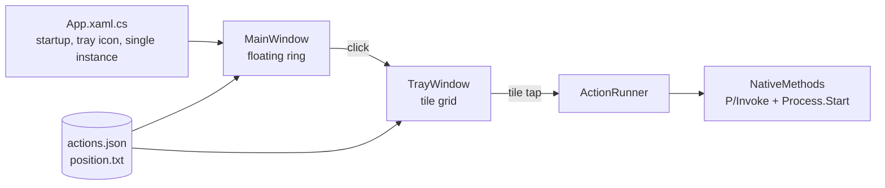

# Floating Ring

A draggable floating button for Windows, inspired by iPhone AssistiveTouch and Android's floating dock. Click the ring and a tray of shortcuts pops up: screenshot, lock, sleep, restart, shut down, volume, open an app, and anything else you add.

Everything is a local system call, so it works **fully offline**. No network access, no telemetry, no accounts.


<!-- Add a screenshot or GIF here:  -->

## Features

- Always-on-top ring that **never steals focus** from the app you're working in
- Drag anywhere; it **snaps to the nearest left/right screen edge** and remembers its position
- Fades to 40% opacity when idle, full opacity on hover
- Tray of 12 default actions, **fully editable through a JSON file** (no recompiling)
- **Two-tap confirmation** for dangerous actions (restart, shut down)
- Multi-monitor and high-DPI aware
- System tray icon: show/hide, edit actions, start with Windows, exit
- Single-instance (a second launch exits quietly)

## Quick start

Requires Windows 10/11 and the [.NET 8 SDK](https://dotnet.microsoft.com/download/dotnet/8.0).

```
dotnet --list-sdks          # check you have 8.0.x
dotnet run
```

Build a single-file exe (needs the .NET 8 Desktop Runtime on the target machine):

```
dotnet publish -c Release -r win-x64 --self-contained false -p:PublishSingleFile=true
```

Output: `bin\Release\net8.0-windows\win-x64\publish\FloatingRing.exe`

For a standalone exe with no runtime needed, use `--self-contained true` (larger file).

## Usage

| Action | Result |
|---|---|
| Click the ring | Open / close the tray |
| Drag the ring | Move it; it snaps to a side edge on release |
| Tap Restart / Shut down once | Tile turns red, "Tap again" |
| Tap it again within 3 s | Action runs |
| Tray icon > Edit actions | Opens `actions.json` in Notepad |

The tray also closes by itself after 8 seconds of inactivity.

## Customizing actions

Actions live in `%AppData%\FloatingRing\actions.json`, created on first run. Edits apply the next time the tray opens.

```json
[
  { "Name": "Lock",     "Icon": "🔒", "Type": "builtin", "Target": "lock" },
  { "Name": "Shut down","Icon": "🔌", "Type": "builtin", "Target": "shutdown", "Confirm": true },
  { "Name": "VS Code",  "Icon": "💻", "Type": "open",    "Target": "C:\\Path\\To\\Code.exe" },
  { "Name": "Downloads","Icon": "📁", "Type": "open",    "Target": "shell:Downloads" },
  { "Name": "Settings", "Icon": "⚙️", "Type": "open",    "Target": "ms-settings:" }
]
```

| Field | Meaning |
|---|---|
| `Name` | Label under the icon |
| `Icon` | Any emoji or short text |
| `Type` | `builtin` or `open` |
| `Target` | Built-in id, or an exe / folder / file / URI to open |
| `Args` | Optional command-line arguments (`open` only) |
| `Confirm` | `true` = needs a second tap |

**Built-in targets:** `screenshot`, `lock`, `sleep`, `restart`, `shutdown`, `signout`, `mute`, `volup`, `voldown`, `playpause`, `next`, `prev`, `desktop`, `taskview`

If `actions.json` is missing or malformed, the app falls back to the defaults. Delete the file to reset.

## Tech stack

| | |
|---|---|
| Language / runtime | C# 12, .NET 8 (`net8.0-windows`) |
| UI | WPF (XAML), transparent layered windows |
| Windows Forms | Only for `NotifyIcon` (system tray) and `Screen` (monitor bounds) |
| Native interop | P/Invoke into `user32.dll` and `powrprof.dll` |
| Config | `System.Text.Json` |
| Dependencies | None (no NuGet packages) |

## Architecture



### Project layout

| File | Responsibility |
|---|---|
| `App.xaml(.cs)` | Entry point, single-instance mutex, `NotifyIcon` and its menu |
| `MainWindow.xaml(.cs)` | The ring: click vs drag detection, edge snapping, idle fade |
| `TrayWindow.xaml(.cs)` | The tile tray: builds buttons from config, placement, confirm logic |
| `ActionItem.cs` | Data model for one action |
| `ActionRunner.cs` | Executes `builtin` and `open` actions |
| `Config.cs` | Loads/saves `actions.json` and the ring position, writes defaults |
| `NativeMethods.cs` | Win32 imports, `ScreenHelper` (DPI-aware work area), `StartupHelper` (registry) |

### How it works

**Not stealing focus.** Both windows get `WS_EX_NOACTIVATE` and `WS_EX_TOOLWINDOW` via `SetWindowLong` after the handle is created. Clicking the ring doesn't activate it, so the app you were using stays focused (important for screenshots and media keys). `WS_EX_TOOLWINDOW` also hides it from Alt+Tab. `ShowActivated="False"` covers the initial show.

**Click vs drag.** On mouse-down the position is recorded. If the pointer moves more than 4 px while the button is held, `DragMove()` takes over (it blocks until release) and the ring then snaps. Otherwise mouse-up counts as a click and toggles the tray.

**Edge snapping and multi-monitor.** `ScreenHelper.WorkArea` takes the window center, converts DIPs to device pixels using the `CompositionTarget` DPI transform, finds the monitor with `Screen.FromPoint`, and converts its working area (taskbar excluded) back to DIPs. A saved position on a disconnected monitor is clamped to the nearest one.

**Tray placement.** The tray is a separate window rather than a resized ring window, so the ring never has a large invisible hit area. `TrayWindow` measures its content, opens toward the center of the screen, and clamps to the work area.

**Two-tap confirm.** The first tap marks the button `Tag="confirm"`, which a template trigger styles red, and starts a 3 s timer. A second tap on the same button runs the action. Any timeout or other tap disarms it.

**Actions.**
- Lock: `LockWorkStation()`
- Sleep: `SetSuspendState(false, false, false)`
- Shut down / restart / sign out: `shutdown.exe /s|/r|/l /t 0`
- Screenshot: launches the `ms-screenclip:` URI (Windows Snipping Tool overlay); the ring hides for 4 s so it isn't captured
- Volume and media: synthesized virtual-key presses with `keybd_event`
- Show desktop / Task View: synthesized Win+D / Win+Tab
- `open`: `Process.Start` with `UseShellExecute = true`, so exes, folders, files and URIs all work

**Start with Windows.** Writes or removes `HKCU\Software\Microsoft\Windows\CurrentVersion\Run\FloatingRing`. No admin rights needed.

### Data locations

| Path | Contents |
|---|---|
| `%AppData%\FloatingRing\actions.json` | Your action list |
| `%AppData%\FloatingRing\position.txt` | Last ring position (`x,y`) |
| `HKCU\...\Run\FloatingRing` | Autostart entry (only if enabled) |

Uninstall: exit from the tray menu, untick "Start with Windows", then delete the exe and the `FloatingRing` folder in `%AppData%`.

## Known limitations

- **Sleep may hibernate** if hibernation is enabled in Windows. Run `powercfg -h off` in an admin terminal to make Sleep a true sleep.
- The ring can't appear above UAC prompts, the lock screen, or some exclusive-fullscreen games.
- Actions run with your normal user rights. Launching elevated apps will show a UAC prompt.
- Emoji rendering depends on Segoe UI Emoji (may be monochrome on older Windows builds).
- Windows only. WPF doesn't run on macOS or Linux.

## Roadmap ideas

- Settings window instead of hand-editing JSON
- Custom image icons per action
- Radial (fan-out) tray animation
- Pages of tiles / folders
- Global hotkey to toggle the tray
- Per-action hotkeys and "run as admin" option

## Contributing

Issues and pull requests are welcome. Please keep the project dependency-free and offline-only.

## License

MIT. See [LICENSE](LICENSE).
